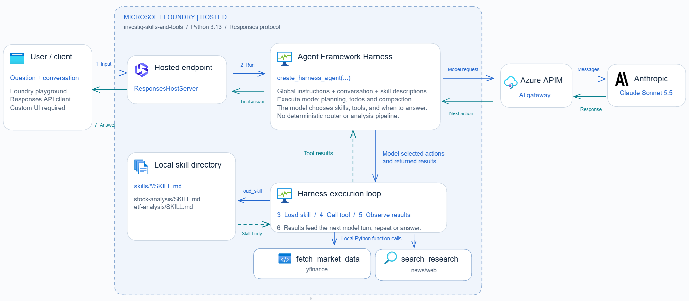

# InvestIQ: local skills and tools

A self-contained investing research agent built with Microsoft Agent Framework Harness,
local skills, and custom market-data and research tools. Anthropic provides the model through
Azure API Management (APIM), and Microsoft Foundry hosts the agent.

## What's here

This repository demonstrates an agent that researches stocks and ETFs and explains investing
concepts. The model selects relevant local Markdown skills, loads their instructions on demand,
and decides which tools are needed to answer each question.

```text
main.py                    Harness factory, two tools, and Responses host
skills/stock-analysis/     Local stock-analysis SKILL.md
skills/etf-analysis/       Local ETF-analysis SKILL.md
requirements.txt          Standalone dependencies
azure.yaml                Foundry hosted-agent deployment configuration
```

The model selects and loads skills on demand and decides which tools to call:

- `fetch_market_data(ticker, function, period)` uses Yahoo Finance for `quote`, `fundamentals`,
  `price_history`, and `etf_holdings`. History ranges: `5d`, `1mo`, `3mo`, `6mo`, `1y`, `2y`.
  Returned data includes ticker, function, range, and UTC fetch timestamp.
- `search_research(query, kind, limit)` uses the DuckDuckGo backend explicitly for `news` or `web`.
  It returns up to eight qualitative snippets with source links, dates when available, and fetch time.

Answers cite the fetched market data and research sources and report missing data or tool errors.
Concept questions can be answered without data tools. Harness planning, todos, compaction, and
history are enabled, with initial mode `execute`. Built-in web search and filesystem access are
disabled; local skill loading is explicitly allowed. Analysis is educational, not investment advice.

## Architecture diagram



A Responses API request reaches the Harness agent hosted in Microsoft Foundry, which calls
Anthropic through APIM. The same agent selects skills, calls tools, and produces a sourced answer.

- **Skill selection:** `SkillsProvider` discovers local Markdown skills and exposes their names
  and descriptions. The model matches them to the question by meaning, then reads the relevant
  full instructions on demand before stock or ETF analysis: `stock-analysis` for company research,
  `etf-analysis` for fund research or comparisons. Skills guide analysis and citations; they are
  not executable workflows or separate agents.
- **Tool selection:** the model uses the question, loaded skill instructions, tool descriptions,
  and parameter schemas to decide which tool to call and with what arguments.
  `fetch_market_data` is the only source for numeric market facts (Yahoo Finance);
  `search_research` provides qualitative news and context (DuckDuckGo). The host validates inputs
  and executes the selected Python function, then returns results to the model, which can make
  further calls or answer with citations and explicit data limitations.
- **Adaptive execution:** skill and tool choices are model-driven, not keyword-routed or a fixed
  sequence. For example, MSFT research may use a quote and news, while an ETF comparison may use
  holdings and fundamentals. Concept questions such as "What is an ETF?" need no data tools.
- **Hosting and safeguards:** skills and tools ship with the agent; read-only skill loading is
  automatically approved while general filesystem access and built-in web search stay disabled.
  APIM credentials come from a Foundry project connection, and optional Application Insights
  telemetry traces execution.

The diagram describes the application architecture, not deployment status.
The [Excalidraw source](docs/harness-skills-tools-flow.excalidraw) remains editable.

## Run locally

From this folder, install into an isolated environment:

```powershell
python -m venv .venv
& .\.venv\Scripts\python.exe -m pip install -r requirements.txt
$env:ANTHROPIC_BASE_URL = "https://your-apim-name.azure-api.net/anthropic"
$env:ANTHROPIC_CHAT_MODEL = "claude-sonnet-5"
$env:ANTHROPIC_MAX_TOKENS = "8192"
# Set APIM_SUBSCRIPTION_KEY securely in your shell before starting.
& .\.venv\Scripts\python.exe main.py
```

The entry point reads environment variables, not a sibling project's `.env` file.
Use the Foundry local invocation tooling in a second terminal to send Responses requests.
See [local development](https://learn.microsoft.com/agent-framework/get-started/hosting?pivots=programming-language-python).

## Local HTML demo

To ask an **already deployed** agent from a browser, use the small local Python server.
It calls `run_question()` in [test.py](test.py) and displays the same text output, including
tool and skill-loading calls only when the endpoint exposes them. No credentials enter the browser.

Use an Azure-authenticated Python environment with `azure-ai-projects>=2.7.0` and `azure-identity`
installed. Check `endpoint`, `agent_name`, and `agent_version` in [test.py](test.py) match your
deployment, then run:

```powershell
python -m pip install "azure-ai-projects>=2.7.0" azure-identity
python .\demo_server.py
```

Open **http://127.0.0.1:8765**, enter a question, and click **Ask agent**.
Keep the terminal open; Ctrl+C stops the server. The page must be served by this Python server,
not opened directly as an HTML file. Each question creates a fresh session and deletes it afterward;
there is no follow-up history. Calls can incur charges. The server accepts only local requests
and runs one invocation at a time. This local client does not deploy or change the hosted agent.

Run the local client and HTTP tests without contacting Foundry:

```powershell
python -m unittest discover -s tests -p test_local_demo.py -v
```

## Foundry configuration

### 1. Prerequisites

- Install the [Azure Developer CLI (`azd`)](https://learn.microsoft.com/azure/developer/azure-developer-cli/install-azd).
  Install its Foundry agents extension as shown below.
- Use an existing [Microsoft Foundry project](https://ai.azure.com/) with hosted-agent support.
  Obtain its project endpoint and project ARM resource ID from the project's configuration.
  Your signed-in identity needs permission to deploy hosted agents into that project.
- Allow outbound access from the hosted runtime to APIM, Yahoo Finance, and DuckDuckGo.
  For optional tracing, also allow Application Insights access and grant the runtime identity
  permission to publish telemetry.

#### Set up the LLM endpoint before deployment

Have an APIM endpoint that forwards Anthropic Messages API requests to an accessible Anthropic
model, with an authorized APIM subscription. Record:

- `ANTHROPIC_BASE_URL`: the APIM Anthropic base URL.
- `ANTHROPIC_CHAT_MODEL`: the model identifier accepted by that endpoint.
- `ANTHROPIC_MAX_TOKENS`: an output-token limit supported by the selected model.

**No separate model deployment or model connection in Foundry is required by this example.**
The Python agent calls Anthropic through APIM directly; Foundry supplies the hosted runtime.
The model must already be accessible behind APIM before you deploy the agent.

#### Set up the Foundry connection before deployment

In the **same Foundry project that will host the agent**, create or reuse a connection with:

| Setting | Required value |
| --- | --- |
| Connection name | `investiq-apim` |
| Credential field name | `APIM_SUBSCRIPTION_KEY` |
| Credential value | Your valid APIM subscription key, stored securely |
| Access | The hosted runtime identity must be allowed to resolve the connection's credentials |

Use your organization's Foundry connection-management process to create the connection and
store the secret. These exact names match the reference in [azure.yaml](azure.yaml):
`connections.investiq-apim.credentials.APIM_SUBSCRIPTION_KEY`. If you choose another name,
update that reference to match. The reference **does not create the connection**.

Setting `$env:APIM_SUBSCRIPTION_KEY` in PowerShell is sufficient for **local execution only**;
it does not create a Foundry connection or supply the hosted agent's secret.
Yahoo Finance and DuckDuckGo need no API keys or Foundry connections. Application Insights
is optional; configure its connection string and telemetry permissions only if you want tracing.

Python 3.13 is the hosted runtime selected in [azure.yaml](azure.yaml); install it locally if
you also want to run the same runtime on your machine. Deployment uses Foundry's remote build,
so this example does not need a local Docker installation or a separately built container image.

### 2. Sign in and select the existing project

Run these PowerShell commands from **this folder**, which contains [azure.yaml](azure.yaml).
Use a separate azd environment so the companion demos' configuration is not changed.
Replace all angle-bracket placeholders with your own values.

```powershell
azd extension install azure.ai.agents
azd auth login
azd env new investiq-skills-tools-dev
azd env set AZURE_SUBSCRIPTION_ID "<subscription-id>"
azd env set AZURE_TENANT_ID "<tenant-id>"
azd env set AZURE_AI_PROJECT_ENDPOINT "https://<foundry-resource>.services.ai.azure.com/api/projects/<project-name>"
azd env set AZURE_AI_PROJECT_ID "/subscriptions/<subscription-id>/resourceGroups/<resource-group>/providers/Microsoft.CognitiveServices/accounts/<foundry-resource>/projects/<project-name>"
azd ai project show --output json
```

Check that the final command identifies the intended project before continuing. For subsequent
terminals, run `azd env select investiq-skills-tools-dev` from this folder to reuse the environment.
This path reuses existing infrastructure: do not run `azd provision` just to deploy this example.
If you do not have a project yet, create one first using the
[Foundry setup guidance](https://learn.microsoft.com/azure/ai-foundry/how-to/create-projects).

### 3. Configure the model endpoint and optional tracing

```powershell
azd env set ANTHROPIC_BASE_URL "https://<your-apim-name>.azure-api.net/anthropic"
azd env set ANTHROPIC_CHAT_MODEL "<model-id-accepted-by-your-apim-endpoint>"
azd env set ANTHROPIC_MAX_TOKENS "8192"
# Leave tracing unconfigured unless you have an Application Insights resource.
azd env set APPLICATIONINSIGHTS_CONNECTION_STRING ""
```

To enable tracing, replace the empty value with your Application Insights connection string,
supplied securely in your deployment environment. Message-content capture is disabled in
[azure.yaml](azure.yaml).

The hosted deployment resolves the APIM key through this existing expression in
[azure.yaml](azure.yaml):

```yaml
APIM_SUBSCRIPTION_KEY: $${{connections.investiq-apim.credentials.APIM_SUBSCRIPTION_KEY}}
```

Do **not** replace it with a literal key or store the APIM key with `azd env set`. Local execution
instead requires `APIM_SUBSCRIPTION_KEY` in the process environment, as described above; azd
environment settings are deployment configuration, not automatically exported PowerShell variables.
Never commit credentials or share environment files or secret-bearing command output.

### 4. Deploy and run in Foundry

```powershell
azd deploy investiq-skills-and-tools
azd ai agent show --output json
azd ai agent invoke "Analyze MSFT using its latest available quote, fundamentals, and recent news. Explain the main business drivers and risks, and cite your sources."
```

Deployment packages [main.py](main.py), [requirements.txt](requirements.txt), and the local
[skills](skills/) directory, then Foundry builds the Python dependencies and registers an agent
version. No Toolbox endpoint, remote skill registration, or Foundry model deployment is needed.
Check that the agent status is `active` or `deployed` before invoking it. Deployment and model
invocations can incur charges; review any CLI confirmation before proceeding.

Open the target project in [Foundry](https://ai.azure.com/), find `investiq-skills-and-tools`
in its agents list, and select the deployed version. Use the Playground link returned by
`azd ai agent show` when available. Start with the stock analysis above, then try an ETF comparison:

```powershell
azd ai agent invoke "Compare VOO and QQQ using available fees, top holdings, and recent context. Explain their exposures and concentration risks, and cite your sources."
```

Confirm the answer cites Yahoo data with a fetch timestamp and DuckDuckGo research with links,
or explicitly reports provider failures. Skill and tool selection remain model-driven.
If tracing is configured, inspect traces for skill loading and both tool calls.
After changing code or local skills, rerun the same deploy command to create a new agent version.

### Troubleshooting

- **Missing project endpoint or wrong project:** select the intended azd environment and recheck
  `AZURE_AI_PROJECT_ENDPOINT` and `AZURE_AI_PROJECT_ID`.
- **Connection resolution or APIM authentication failure:** verify the `investiq-apim` connection,
  its exact credential field name, runtime access, APIM URL, and accepted model identifier.
  Do not print the credential to diagnose the issue.
- **Agent fails to start or deploy:** run `azd ai agent doctor --output json` and inspect the
  reported configuration or startup error.
- **Yahoo or DuckDuckGo fails:** check runtime outbound access and provider rate limits.
  The tools report errors rather than fabricating fallback market facts.

See the [Foundry deployment configuration reference](https://learn.microsoft.com/azure/foundry/agents/concepts/azure-yaml-reference)
and [hosted-agent overview](https://learn.microsoft.com/azure/ai-foundry/agents/concepts/hosted-agents?view=foundry)
for platform requirements. No cloud resources are created just by adding this folder or editing
this README.

## Test questions

Try these in the Foundry Playground or with `azd ai agent invoke "<question>"`:

| Focus | Question |
| --- | --- |
| Stock analysis | "Analyze MSFT using its latest available quote, fundamentals, and recent news. What are its main business drivers and risks?" |
| Stock news | "What has been driving NVDA lately? Separate news-backed developments from your interpretation." |
| Stock price history | "Show AAPL's daily closing prices for the last five trading days, with the currency and fetch timestamp." |
| ETF analysis | "Analyze VTI's objective, available fees, top holdings, and concentration risks." |
| ETF comparison | "Compare VOO and QQQ using available fees, top holdings, and recent context. How do their exposures differ?" |
| Missing data | "Use the ETF-analysis skill to research MSFT's ETF holdings. If the request does not apply or data is unavailable, explain why rather than inventing holdings." |
| Concept explanation | "What is an ETF, and how does an expense ratio work?" |

For data-backed answers, check for Yahoo source metadata, research links when used, honest
reporting of missing data, and the educational disclaimer. The concept question should need no
data tools. These are manual checks, not guarantees of a particular tool-call sequence.

Inspect Foundry traces for skill loading, `fetch_market_data`, and `search_research`.
Skill/tool selection is model-driven rather than guaranteed by application routing.
To add a skill, create `skills/<name>/SKILL.md` with `name` and `description` front matter.
The Harness discovers it when constructing an agent; no router edits are needed.

## Tests

From the workspace root, using its existing development environment:

```powershell
& .\.venv\Scripts\python.exe -m pytest -q tests\test_skills_tools_hosting.py
```

Tests cover tool input validation, source metadata, provider failures, host lifecycle, and the
real Harness skill-loading/tool-calling loop with mocked Anthropic and data-provider responses.
They do not contact APIM, Foundry, Yahoo Finance, or DuckDuckGo.

## Demo boundaries

Yahoo Finance and DuckDuckGo are unofficial services and can rate-limit or fail. Tool calls are
time-bounded and return explicit provider errors; they do not fabricate fallback answers or retry
data requests. Thread timeouts stop awaiting work, not the underlying thread. The SDK retries model
requests at most twice. No persistent market cache or durable conversation store is implemented.
Quote snapshots can be delayed; fetch time is not the exchange timestamp. History uses unadjusted
daily closes, not dividend-adjusted total returns. ETF holdings may be unavailable.
Research snippets may contain numbers, but must never be cited as numeric market evidence.

Educational analysis only, not investment advice.
